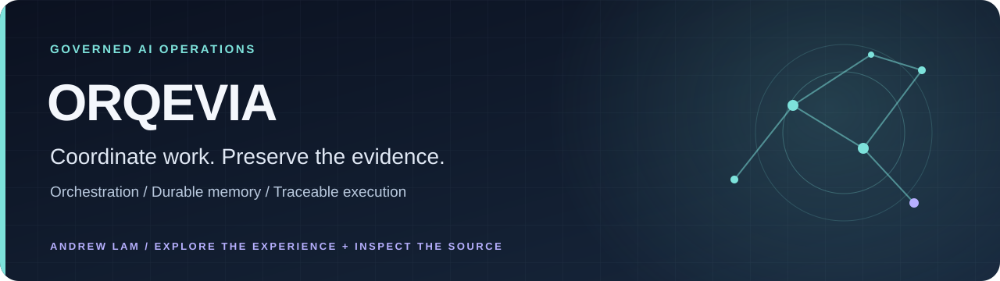
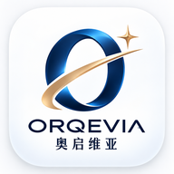

[](https://authority-engine-app.vercel.app/orqevia)

<p align="center">
  
</p>

# ORQEVIA · 奥启维亚

### Local intelligence, useful tools and recoverable missions

[Public walkthrough](https://authority-engine-app.vercel.app/orqevia) ·
[Architecture](docs/TOTAL-INTEGRATION-ARCHITECTURE.md) ·
[Current status](STATUS.md) ·
[Issues](https://github.com/AndrewLamSingapore/orqevia/issues) ·
[Discussions](https://github.com/AndrewLamSingapore/orqevia/discussions) ·
[Wiki](https://github.com/AndrewLamSingapore/orqevia/wiki) ·
[Contact](https://authority-engine-app.vercel.app/contact?source=orqevia&intent=collaboration)


ORQEVIA is an intelligence and execution workspace. It separates what was
observed, what a model recommends and what the system was authorized to do.
The result is a working environment for bounded analysis, traceable execution,
durable memory and operational evidence.

The public walkthrough is open. The owner workspace is protected by Cloudflare
Access, TLS and server-side session authorization.

## Current execution model - 6 November 2026

Read [the current source state](ORQEVIA-CURRENT-STATE.md) and [the consolidated estate sweep](docs/ESTATE-SWEEP-20261106.md). The native capability inventory has no lead/reporting authority; desktop and mobile share one HTTPS workspace. Parked useful engineering is consolidated with the dependency updates. Historical data, trust boundaries and recovery evidence are retained. Source facts and actual deployment verification remain separate.

### Direct execution foundations

Ordinary authorized objectives use direct task dispatch, task-qualified models,
shared knowledge and recoverable execution records. Capability identities are
an inventory, not a required management hierarchy. Scoped authentication,
secrets, consequential-action permissions and resource capacity remain technical
boundaries. The source release check verifies component hashes and capability
identity; historical portfolio manifests and generated checkpoints do not grant
runtime authority or gate the current release.

The live ABEX handoff is the workspace-root `ORQEVIA-CURRENT-STATE.md`.
Deployment receipts, not source documentation, establish what is running.
Older release/status material below remains dated evidence where its assumptions
have been superseded by the Owner mission.

## Start here

| You want to… | Go to |
| --- | --- |
| Explore the product | [Public walkthrough](https://authority-engine-app.vercel.app/orqevia); the operational workspace requires authenticated access |
| Understand the source | [System map](#system-map), [architecture](docs/TOTAL-INTEGRATION-ARCHITECTURE.md) and [PWA guide](clients/pwa/README.md) |
| Inspect evidence | [Dated status claims](STATUS.md) and [local verification](#local-verification); source and CI do not establish current deployment |

[Browse all six projects and their source](https://github.com/AndrewLamSingapore/AndrewLamSingapore#selected-work) · [About Andrew](https://authority-engine-app.vercel.app/about)

## What makes it different

- **Evidence is a first-class output.** Task results, runtime identity,
  artifacts, permissions and deployment state are recorded separately.
- **Execution is bounded.** Role, security, evidence and task instructions
  remain above model output; sensitive actions fail closed.
- **Operations stay explainable.** Deterministic calculations, model
  contributions and cited reference data are presented distinctly.
- **The workspace is durable.** Decision memory, notebooks, task history and
  artifacts survive restarts through persistent storage.
- **The interface is practical.** Desktop and installable PWA surfaces retain
  explicit loading, offline, failure, recovery and access states.

## Core capabilities

| Area | What it provides |
| --- | --- |
| Orchestration | Task decomposition, bounded handoffs, retries and terminal outcomes |
| Evidence | Execution receipts, artifact hashes, provenance and runtime binding |
| Memory | Durable decisions, searchable agent notebooks and scoped project/organization records |
| Intelligence | Operations telemetry, geospatial observations, source-grounded retrieval and cited evidence |
| Security | Owner/member isolation, credential protection, spending boundaries and recovery |
| Interfaces | Authenticated PWA, mobile-safe layouts and service-backed operational views |

## System map

```text
Owner / trusted device
        |
   TLS + Access + session authorization
        |
   ORQEVIA PWA / interface
        |
   objective and workflow orchestration
        |
   bounded agent roles + evidence ledger + durable memory
        |
   local models / compatible cloud providers / approved tools
        |
   results, receipts, artifacts and rollback state
```

## Public ecosystem

- [Authority Engine](https://authority-engine-app.vercel.app/) — public
  operations-intelligence portfolio and evidence hub.
- [VELYQUA](https://velyqua.vercel.app/) — software-first living-water
  intelligence.
- [The Portal](https://the-portal-ten.vercel.app/) — discovery and
  knowledge-graph experiment.
- [Living Worlds](https://game-platform-wine-nine.vercel.app/) — governed,
  persistent world simulation.
- [The Sky Tablet](https://sky-tablet.vercel.app/) — Mesopotamian astronomy and
  cuneiform experience.

## Trust and evidence

`STATUS.md` records dated portfolio claims and evidence classification. The
[operational manifest](https://github.com/AndrewLamSingapore/orqevia/blob/main/governance/operational-manifest.json) and
[channel contract](governance/CHANNEL_CONTRACT.md) are machine-readable
architecture references; neither substitutes for an observed runtime receipt.
Historical, synthetic and live evidence remain explicitly separated.

Credentials, production data and provider entitlements stay external to source
control. Deployment, rollback and access controls are intentionally preserved.
The standing [fast-model policy](docs/FAST-MODEL-POLICY.md) prohibits slow local
models and keeps reasoning at maximum.

## Local verification

```powershell
python scripts/validate_canonical.py
python scripts/check_canonical_state.py
python scripts/run_canonical_ci.py
```

Use an isolated `ORQEVIA_DATA_DIR` and `ORQEVIA_COMPUTE_QUEUE_DB`. PWA checks are
documented in [clients/pwa/README.md](clients/pwa/README.md).

## License

MIT. See [LICENSE](LICENSE).
