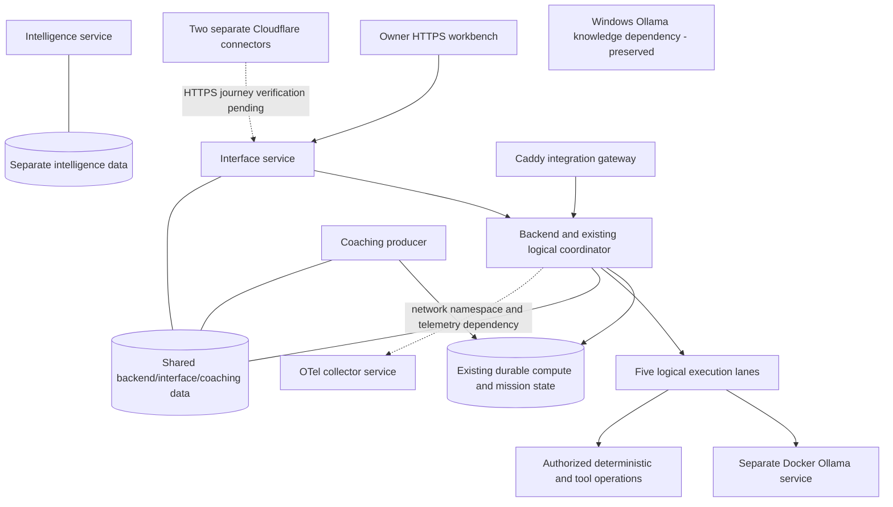

> Portfolio status is recorded in [STATUS.md](../STATUS.md). This document describes this repository only; current runtime and deployment claims require evidence from their owning domains.

# JARVIS PRIME Architecture v1

## Permanent Owner decision - multi-service deployment - 28 October 2026

**Multiple service containers are ABEX-ORQEVIA's primary deployment architecture.**
This decision governs future engineering and optimization until the Owner
explicitly changes it. One coherent system and one logical coordination
authority do not require one executable, one container or21agent containers.
This deployment decision specializes the
[Intelligent Efficiency Doctrine](INTELLIGENT_EFFICIENCY_DOCTRINE.md).

### Architectural rules

| Rule | Standing requirement |
|---|---|
| A | Preserve multi-service containers as the primary deployment model; no giant monolithic redesign. |
| B | One authoritative logical coordinator governs expensive workload admission, routing, ownership, fairness, deduplication and recovery. Reuse the backend; a new coordinator container requires technical evidence. |
| C | Preserve21logical agent identities and permissions on shared execution infrastructure;21agents do not require21containers or workers. |
| D | Keep Ollama an independently governed inference service, preserving Windows Ollama's knowledge-service dependency and existing model assets. |
| E | Every new container needs a documented operational purpose, measured cost, dependencies, persistence, health/recovery plan and justification for not reusing an existing service. |
| F | Container consolidation needs measured benefits, a dependency/recovery assessment and explicit Owner approval. Container count alone is insufficient justification. |
| G | Architectural changes preserve service boundaries, security, availability, data, independent recoverability and measured resource efficiency. |
| H | The Owner-controlled production background pause persists until explicit Owner resume. Architecture work never implies autonomous production resumption. |

Preserve backend, interface, coaching, intelligence, integration gateway,
inference, observability and external-connectivity responsibilities. Services
may coordinate their internal operations locally but must obey shared rules
for expensive inference and autonomous workload admission. Do not remove or
recreate containers, images, networks or volumes merely to enforce this policy.

The [five execution lanes and coordinator pathway](MULTI-LANE-EXECUTION-PATHWAY.md)
are logical task paths: deterministic, lightweight, embeddings, deep reasoning,
and tools/integrations. Safe non-inference work can progress independently;
heavy inference parallelism and residency changes require benchmarks.

### Verified observation versus intended architecture

Read-only inspection at10:12UTC28October found17containers,9running,69unique
images,15volumes,7networks and3Compose projects. The nine running roles are
backend, interface, coaching, intelligence, Caddy integration gateway, Docker
Ollama, OTel collector and two Cloudflare connectors. All five declared Docker
health checks passed. Four services have no declared Docker health check;
their process state is not complete functional readiness evidence.

The coordinator already resides in the backend, but the running dispatch mode
is still `direct` with `balanced` compute configuration. Full shared inference
admission, HOME_ECO/ULTRA_ECO, global deduplication and complete monitoring are
not runtime-verified. The durable compute-job background pause is separately
enforced in the existing database, generation0. No new background job started
after pause activation in the observed journal; registration remains21.

Process isolation is present. Recovery independence still needs qualification:
backend/interface/coaching share one data volume; OTel shares the backend's
network namespace; intelligence also belongs to a retained staging network.
These are review findings, not permission to remove dependencies or resources.

The diagram records service boundaries and declared/observed dependencies.
Dashed connectivity requires further functional verification. It does not
claim that every existing inference producer already obeys the proposed policy.
Current operational evidence and unresolved work remain in
[the handover](moe/07-LIVE-PAUSE-HANDOVER.md) and the unified engineering mission.

### Change and acceptance procedure

Inspect live identities, Compose references, volumes, networks, active work and
backup coverage before a material service change. Test fault isolation,
readiness, bounded retries, pause persistence, accepted-job recovery and resource
cost at the affected boundaries. Keep ordinary background production paused.
Use isolated tests; obtain required approval for disruptive changes. Verify
running revisions and functional behavior after deployment, then record rollback.
Do not claim architecture-wide compliance from a diagram, unit tests or low idle CPU.

The earlier architecture text below remains historical context where it conflicts
with this Owner decision; it does not authorize merging service boundaries.

This successor defines current intended architecture and supersedes conflicting earlier architecture, including governance/OPERATIONAL_BASELINE_v1.md. Historical documents and parent Git history remain unchanged; historical evidence is not invalidated by superseded ceremonial rules.

Owner → Dell / mobile PWA / PWA voice → one authenticated HTTPS Interface contract → ABEX PRIME → automatic deterministic / qualified Local Nano / Cloud Mini / Cloud Flagship routing → appropriate canonical 21-agent subset → tools, execution, independent validation and bounded repair → one task/artifact namespace → originating or explicitly linked owner client.

Client identity does not grant execution authority. Server policy selects routing and cost/data-locality bounds; clients cannot select models or authority. Ordinary bounded work uses direct observed execution with narrow consequential controls. Action records primarily preserve evidence.

## Intentional evolution

- 29 agents → canonical 21; Git history preserves the former registry.
- Universal TAP/Harness/Stable-Spine pre-execution gates → direct execution for ordinary bounded work, narrow consequential controls.
- Action Envelope/Ledger gating → primarily evidence/logging.
- Dell operator machine → authenticated first-class client and independent verifier.
- Native iPhone → canonical mobile PWA with platform-dependent voice and text fallback.
- Local-centric inference → deterministic/local/cloud elastic routing.
- Separate interface assumptions → unified multi-client Interface Node.

Continuation reserves additive revisions in the existing objectives database; original steps and artifacts remain unchanged. Linked devices can continue the same terminal task. Concurrent conflicts and uncertain dispatches fail closed. Current revision results are distinguished from history. GPU/NPU and physical client capabilities are qualified only by execution evidence.

## Product truth

Git defines intended product state. Runtime defines deployed state. Evidence proves their correspondence. Change canonical source → test → commit → package → deploy → verify → record revision-aware evidence. Private deployment material remains external. Legacy Compose and startup examples remain historical compatibility material; deploy/product-runtime-v1.json describes current entrypoints and external inputs. This repository alone does not prove a live deployment.
