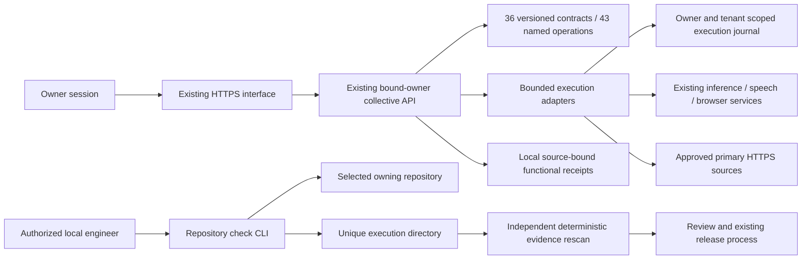

# Fabric control plane and supported workbench operations

This increment extends the existing ORQEVIA stack. It adds no model, database,
public inference endpoint, product dependency or permanent agent.

`GET /api/collective/v1/fabrics/registry` and the existing
`/interface/v1/collective/fabrics/registry` gateway expose 36 versioned contracts.
The backend uses the existing bound-owner authentication. The interface uses
its configured workspace access mode and server-held forwarding credentials.
Registry discovery does not grant permission to execute a tool. No fabric
execution endpoint accepts arbitrary commands.

The Operations page discovers the real registry, selects a fabric and operation,
shows its scope and schemas, and submits explicit JSON parameters. Discovery and
selection never start an operation. Each response includes its execution UUID,
source revision and hashes. A lost response is recovered through
`GET /interface/v1/collective/fabrics/executions/{uuid}`; the browser never retries
an ambiguous POST automatically. Session changes and offline transitions clear
private inputs and results.

An execution UUID also binds its operation contract version. A POST attempting
to reuse it after that version changes receives 409, preserving the original
receipt. Historical GET recovery still returns the original source, version,
result and hashes. A new operation requires a new UUID. Before recording a fresh
result as COMPLETED, the runtime checks its declared supported output-schema
vocabulary and size; malformed output becomes a sanitized failed receipt without
retaining the provider's invalid payload. This shape check is not independent
verification of the result's factual correctness.

Speech results expose explicit playback and download only after validating the
PCM16 WAV container and SHA-256. They do not autoplay. Image inspection and
measurement accept an optional PNG picker with a 512 KiB limit, signature
validation and original-byte preservation. These operations provide supported
measurements, not general image semantics or speech recognition.

Authenticated discovery also supports `?summary=1` for compact routing metadata
and `?fabric_id=f04` for one complete contract. The default response remains the
complete catalog. Unknown or duplicated query parameters are rejected.



Discovery reports implementations separately from current operational evidence.
Historical receipts remain recorded. Current VERIFIED requires a matching fabric,
version, runtime source, functional scope, named executed checks, receipt hash
and a validity window no longer than 24 hours. Readiness alone cannot pass.
Expired receipts become DEGRADED. Wrong-source, corrupted or missing evidence
remains unverified. An administrator can rewrite local files: this is not remote
attestation or an external tamper-proof anchor.

The optional evidence index is `$ORQEVIA_DATA_DIR/fabric-evidence/index.json`:

```json
{
  "schema": "orqevia.fabric-evidence.v1",
  "observations": [{
    "fabric_id": "f06",
    "version": "1.0.0",
    "runtime_revision": "<40-character deployed source revision>",
    "kind": "FUNCTIONAL",
    "scope": "SYNTHETIC_QUADRATIC_REFERENCE_ONLY",
    "observed_at": "<timezone-aware execution timestamp>",
    "expires_at": "<no more than 24 hours later>",
    "path": "execution.json",
    "sha256": "<SHA-256 of the original receipt>"
  }]
}
```

The referenced JSON must bind the same identity, source, scope and timestamps,
contain `status: PASS` or `FAIL`, and include a nonempty `checks` array of named
executed checks with individual PASS/FAIL statuses. Model assertions alone must
never be issued as functional execution receipts. Indexes are installed through
the existing administrator release process, not by a public reporting route.

Run a selected repository's existing checks:

```powershell
python scripts/evaluate_repository.py --repository C:/path/to/owning-repository --profile node --evidence-root C:/path/to/evidence
python scripts/evaluate_repository.py --verify C:/path/to/evidence/execution-id
```

Profiles are `python`, `node` and `static-web`. The local caller explicitly
authorizes execution of the selected repository's test code. Checks run
sequentially, have finite deadlines, stop on cancellation and bound saved logs.
The process inherits a small environment without provider credentials. This is
not a sandbox and does not promise to prevent trusted test code from reading its
own configuration files. No dependencies are installed by the runner.

Receipts retain intent, Git source and tracked content fingerprints before and
after execution, runner hash, exit codes, log hashes and optional JUnit evidence.
The verifier recounts executed test cases instead of trusting suite counters.
Failed exits, changed repository bytes, missing or changed artifacts, timeout,
cancellation and excessive output cannot pass. A dirty repository may receive
diagnostic results but is never release eligible. A passed test receipt does not
authorize publication, independently review AI output or prove a deployment.

ORQEVIA, Game Platform and Sky Tablet retain separate repositories, databases
and deployment lifecycles. This optional evaluation runner reads or executes
authorized tests in the owning repository without becoming a runtime dependency.

All 36 supported HTTP fabric contracts describe their actual request wrapper,
typed operation inputs and results, persisted execution receipt and response
envelope. The catalog contains 43 named operations. The separate F10/F12 local
operator contracts remain under `local_entrypoint_contract`. Definition and
schema validation do not change a fabric to VERIFIED; fresh functional evidence
for its stated scope is still required.

F19 retains source-attributed local observations and adds primary-source HTTPS
retrieval. This operation accepts only the documented exact primary hosts,
validates every redirect, limits response size and excerpt length, rejects
credentials and nonstandard ports, and has a hard 20-second deadline. It records
the final URL, retrieval time, media type, byte count and content hash. A fetched
page or excerpt is source material, not a verified fact or an instruction to
execute. It performs no model invocation or paid generation.

The deployment qualification includes actual HTTPS request/result validation
against Draft 2020-12 schemas, independent numerical/content/hash oracles,
persisted readback, deliberate rejection checks and real browser interactions.
Keep failed receipts: contract mismatches discovered in staging must be corrected
and retested before promotion. Source tests, CI, staging and production receipts
remain separate records.

Existing financial scenario calculations and last-value forecast evaluation
are reused. Full forecasting, general multimodal understanding, physical
automation, confidential-computing hardware guarantees and broader fabric
roadmaps are not certified by these operation contracts.
