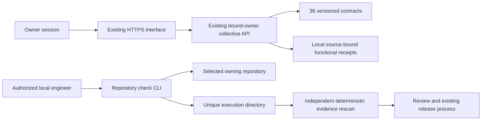

# Fabric evidence and repository execution increment

This increment extends the existing ORQEVIA stack. It adds no model, database,
public inference endpoint, product dependency or permanent agent.

`GET /api/collective/v1/fabrics/registry` and the existing
`/interface/v1/collective/fabrics/registry` gateway expose 36 versioned contracts.
Both use the existing bound-owner authentication. Registry discovery does not
grant permission to execute a tool. No HTTP endpoint accepts arbitrary commands.



Discovery reports implementations separately from current operational evidence.
Historical receipts remain recorded. Current VERIFIED requires a matching fabric,
version, runtime source, functional scope, named executed checks, receipt hash
and a validity window no longer than 24 hours. Readiness alone cannot pass.
Expired receipts become DEGRADED. Wrong-source, corrupted or missing evidence
remains unverified. An administrator can rewrite local files: this is not remote
attestation or an external tamper-proof anchor.

The optional evidence index is `$ORQEVIA_DATA_DIR/fabric-evidence/index.json`:

```json
{
  "schema": "orqevia.fabric-evidence.v1",
  "observations": [{
    "fabric_id": "f06",
    "version": "1.0.0",
    "runtime_revision": "<40-character deployed source revision>",
    "kind": "FUNCTIONAL",
    "scope": "SYNTHETIC_QUADRATIC_REFERENCE_ONLY",
    "observed_at": "<timezone-aware execution timestamp>",
    "expires_at": "<no more than 24 hours later>",
    "path": "execution.json",
    "sha256": "<SHA-256 of the original receipt>"
  }]
}
```

The referenced JSON must bind the same identity, source, scope and timestamps,
contain `status: PASS` or `FAIL`, and include a nonempty `checks` array of named
executed checks with individual PASS/FAIL statuses. Model assertions alone must
never be issued as functional execution receipts. Indexes are installed through
the existing administrator release process, not by a public reporting route.

Run a selected repository's existing checks:

```powershell
python scripts/evaluate_repository.py --repository C:/path/to/owning-repository --profile node --evidence-root C:/path/to/evidence
python scripts/evaluate_repository.py --verify C:/path/to/evidence/execution-id
```

Profiles are `python`, `node` and `static-web`. The local caller explicitly
authorizes execution of the selected repository's test code. Checks run
sequentially, have finite deadlines, stop on cancellation and bound saved logs.
The process inherits a small environment without provider credentials. This is
not a sandbox and does not promise to prevent trusted test code from reading its
own configuration files. No dependencies are installed by the runner.

Receipts retain intent, Git source and tracked content fingerprints before and
after execution, runner hash, exit codes, log hashes and optional JUnit evidence.
The verifier recounts executed test cases instead of trusting suite counters.
Failed exits, changed repository bytes, missing or changed artifacts, timeout,
cancellation and excessive output cannot pass. A dirty repository may receive
diagnostic results but is never release eligible. A passed test receipt does not
authorize publication, independently review AI output or prove a deployment.

ORQEVIA, Game Platform and Sky Tablet retain separate repositories, databases
and deployment lifecycles. This optional evaluation runner reads or executes
authorized tests in the owning repository without becoming a runtime dependency.

F10 and F12 now document concrete schemas for their listed local operations.
Other incomplete schemas are explicitly PARTIAL. Existing financial scenario
calculations and last-value forecast evaluation are inventoried rather than
duplicated. Full forecasting, advanced intelligence, physical automation and
confidential computing are not certified by this increment.
