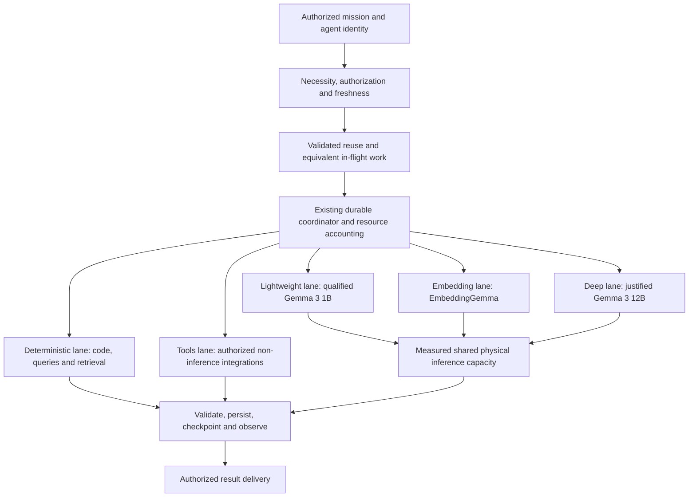

# Coordinated five-lane execution pathway

Owner-approved direction, 28 October 2026. **UNDER IMPLEMENTATION.**
Canonical authority: [Intelligent Efficiency Doctrine](INTELLIGENT_EFFICIENCY_DOCTRINE.md).
The persistent production background pause stays active until explicit Owner resume.

Five logical lanes reuse the current dispatcher, databases and model server.
They do not imply five services, five resident models or five simultaneous LLM
requests. Deterministic work need not wait for an inference slot, but still
respects host resource headroom. All21logical agent capabilities remain on demand.

Latest consolidated execution plan: [Master P0 mission](MASTER-P0-ENGINEERING-MISSION.md).
Engineering is checkpointed for the Owner's shutdown and later continuation.

## Intelligent central coordinator

Extend the existing coordinator as the single logical decision authority for
necessity, routing, priorities, atomic ownership, resource accounting, reuse,
pause/cancellation and recovery. Do not create a competing coordinator or make
every admission decision an LLM call. One authoritative policy can be enforced
across processes through existing durable state and atomic claims.

Inputs include registered capabilities, mission/dependency state, authorization,
freshness, queue age, residency, CPU/RAM pressure and observed quality/performance.
Classify deterministically first. Use a small model only for justified ambiguous
classification; do not use12B simply to decide whether12B is needed.

Begin predictions with bounded per-task/model statistics: sample count, median,
upper latency/memory quantiles, model-load overhead and token usage. Preserve
UNKNOWN and wide uncertainty when samples are sparse. Record predicted versus
actual cost and validation outcomes; do not promise exact predictions.

Explain significant decisions with fixed reason codes and bounded metadata:
execute, defer, reuse, join-equivalent-work, route, escalate, checkpoint or seek
required Owner authority. Do not log private prompts/secrets or create expensive
continuous telemetry. Measure the coordinator's own CPU/RAM/latency overhead.

This is **planned architecture**, not an implemented predictive or self-learning
runtime. The current pause protects compute-job admission; every remaining raw
inference path still needs verified common admission and ownership coverage.

## Coordinator coaching and controlled adaptation

The Owner asked whether the coordinator can be coached. Use event-driven review
of completed outcomes, failures and prediction drift. Compare policies on held-out
recorded tasks without replaying external side effects or generating work solely
to improve a dashboard count. Coach decisions, not an illusion of model autonomy.

Evaluate necessity, quality, model choice, resource estimates, fairness, duplicate
suppression and recovery. Propose small versioned adjustments, run regression and
resource tests, retain rollback, and promote only supported changes within Owner
authority. Use independent review for consequential decisions. No continuous12B
coach, uncontrolled self-modification, automatic production resume, relaxed
security, weaker quality oracle or silent resource-ceiling increase is permitted.

Fine-tuning another neural model is not required. Rules and statistical calibration
are the first implementation. Coordinator coaching is **PENDING**, not deployed.

## Required control behavior

- All producers declare mission/agent identity, workload category, quality needs,
  authorization scope and cancellation state. No invisible direct-call bypass.
- Central durable admission provides priority, per-agent fairness, aging,
  bounded waiting, staggered background work and explicit ownership.
- Background pause survives successor creation, cleanup and restart. Only
  explicitly authorized isolated tests may execute without resuming production.
- Waiting does not consume an active execution budget. Use progress-aware
  watchdogs, bounded retries and useful resumable stages.
- Deduplicate only equivalent authorized work; pin input/configuration/model
  fingerprints and freshness. Preserve independent review and individual delivery.
- Begin with one heavyweight request and one loaded model. Keep2minute retention.
  Larger parallelism requires a demonstrated net benefit and memory headroom.
- HOME_ECO becomes default only after equivalent-work quality/resource tests
  and actual deployment verification. ULTRA_ECO is selectable stronger conservation.

## Current evidence and unresolved acceptance

| Item | State |
|---|---|
| Owner background pause | DEPLOYED and RUNTIME VERIFIED in existing DB |
| Supervisor no longer clears pause | DEPLOYED and RUNTIME VERIFIED |
| Natural12B unloading | RUNTIME VERIFIED; no restart used |
| Existing task-aware selector | Live deterministic route inspection chooses1B/classification and12B/planning |
| Lightweight model qualification | Six schema-constrained classification trials passed; initial schema-free output failed |
| Embedding qualification | One batch passed finite-vector/dimension/identical-input checks |
| Deep reasoning qualification | FAILED: single-slot scheduling answer violated occupied-slot constraints; oracle unchanged |
| CPU-thread choice | Preliminary1B4/6/8 comparison only; no production thread setting enabled |
| Shared patient scheduler | Source tested; not deployed |
| Global single-flight | Saved WIP; not integrated or production verified |
| Monitoring truth repair | Source classification tests passed; UI/API deployment and3functional probes pending |
| Complete HOME_ECO/ULTRA_ECO | PENDING; not claimed from profile labels |
|21agent current end-to-end capability | PENDING; registration/history are not quality acceptance |

GPU discovery already found Ryzen7PRO8840HS/16logical CPUs and Radeon780M. Current
Docker Ollama has no GPU mapping and uses CPU. Supported acceleration is not
established. Do not repeat discovery, install drivers or change host settings
without a concrete reason and the required approval.

## Resume order

1. Read the current checkpoint and recheck pause, active work, images and model inventory.
2. Resolve the deep correctness failure without weakening the oracle; use
   deterministic computation for the scheduling calculation if appropriate,
   while separately qualifying genuinely necessary deep inference.
3. Separate service functionality, monitoring coverage, verification warnings,
   recent execution evidence and intentional pause in API/dashboard reporting.
   The missing gateway/tunnel HTTPS probes must remain explicit until verified.
4. Finish and test durable cross-process deduplication, common admission,
   fair scheduling and patient budgets across every reachable producer.
5. Run small sequential authorized tests, then prepare exact deployment/rollback
   steps. Production service interruption requires the Owner's required approval.
6. Verify deployed behavior before requesting explicit production background resume.

Engineering is saved for continuation. No normal production background resume,
model deletion, concurrency increase or cloud expenditure is authorized here.
