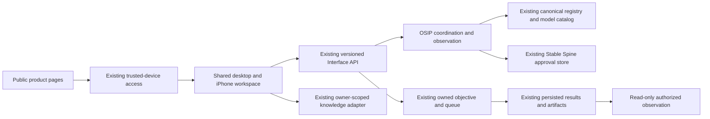

# ORQEVIA 2.0 modernization candidate

## Release checkpoint — 23 October, 06:25 UTC

This checkpoint supersedes the initial qualification and recovery counts below;
those earlier findings remain dated execution history. Production application
source is still `98b25373207dd55bd1326260a59ebc917144d770`. The candidate is a
staging release. Canonical main was freshly fetched at
`93d78f2818dbc143e41f85755d3e44622ec76cb6`; its additional Academy changes were
preserved in candidate merge `8078912745ed6d1a64fa2ca45178378fefe91afa`.

The previously committed candidate `28c4164214517011f9c3e0a506b78e187c5951a8`
passed 18 actual isolated-stage acceptance checks: six public pages, trusted
login, shared registry/model projection, plan-to-queue execution, persisted
result and digest-verified evidence, real document ingestion and retrieval,
local grounded generation, Stable Spine decision recording, origin/member
denials, offline recovery, service restart continuity and an iPhone-sized
WebKit viewport. Decision recording does not automatically resume an external
executor. Physical iPhone installation and authenticated public Access remain
unverified.

The merged candidate's full Python run passed 5,222 tests, four Windows symlink
skips and 92 subtests in 229.07 seconds. Twenty-five focused contract/security
tests also passed. The shared PWA has
86 passing JavaScript checks and 18 passing Chromium/Firefox/WebKit browser
fixtures. Fixture checks are distinct from authenticated live-stage acceptance.

### Optional observations and semantic assessment

New fixed-source adapters collect public OpenSky aircraft states for the
Singapore bounding box, NOAA NDBC marine weather and Council of the EU
press-release headlines. The original UN feed returned HTTP 404 in the
container and is parked by the Owner's subsequent instruction. The documented
Council RSS feed returned 200 with 20 actual records; it is the active
geopolitical reference, explicitly limited to EU institutional policy reporting.
See the Council's [RSS documentation](https://www.consilium.europa.eu/en/about-site/rss/)
and [source reuse notice](https://www.consilium.europa.eu/about-site/copyright/).
Collection is bounded to two MiB and 12 seconds per source, with a minimum
15-minute interval, no private prompts or credentials, provider provenance,
payload hashes and a bounded evidence journal. Prior observations survive
provider errors with explicit stale/unavailable status. Source freshness is
checked separately from collection freshness. NOAA weather is not vessel AIS;
headlines are attributed reporting, not independently verified geopolitical
facts. The combined adapters still require authenticated stage acceptance.

The offline semantic adapter pins
`cross-encoder/nli-deberta-v3-base` revision
`6c749ce3425cd33b46d187e45b92bbf96ee12ec7`, Apache-2.0, standard ONNX export
SHA-256 `369ebf04fce8206c83b8fd62e9dc860144f10351a7f885ed3076beb17b7c6dda`.
It uses CPU inference, verified tokenizer/model files, no remote Python or
pickle execution, no network/model download and no input persistence.
The unchanged declared synthetic acceptance rule was at least 14/16 top-label
matches with zero confident false entailments. Actual results were 14/16,
zero confident false entailments, median 0.0285 seconds after including the
initial load among 16 timings, and 1,400,160,256 bytes observed RSS. Both misses
were neutral examples classified as contradictions. Scores are uncalibrated.
The complete [qualification receipt](evidence/orqevia2-20261023/nli-standard-qualification.json)
is retained; this is not broad model, fact-truth or formal-proof certification.
The smaller candidate failed the threshold; a quantized base export failed
loading and structural validation. Both failed receipts remain outside Git.

GOD'S EYE reads the stored provider snapshots and semantic health. Collection
and premise/claim assessment controls exist only in Intelligence and preserve
the existing exact-owner, session and origin checks. No execution authority,
fact-verification authority or browser caching of private responses is added.
Only the staging model proxy joins the production inference network; knowledge
uses the isolated network and pinned read-only model mounts with a three-GiB
limit. Staging has separate data and credentials and no paid cloud execution.

### Admission incident and host readiness

A separate CLI session twice reverted production from pairing to open
admission. Its exact changes were found in its tool history. Under the Owner's
instruction that only this session should change ORQEVIA, that confirmed CLI
was stopped; production pairing was restored without changing the source
image. A private SQLite backup preceded targeted revocation of ten device and
session pairs issued during the two proven open-admission windows. The
dedicated workbench credential and earlier devices were preserved. A fresh
normal-TLS Edge run passed anonymous denial, original workbench identity,
secure scoped cookies, real service reads and trusted refresh without new
enrollment. This establishes containment and access recovery, not a forensic
claim that no data was accessed during the windows.

Both local Codex configurations already use unrestricted filesystem access
and `approval_policy = "never"`; no local deny rules were found. Codex Doctor
reported zero failures. A separate execution review rejected a compound
startup-recovery command with only `blocked by policy`, without a specific
rationale. No policy gate was removed. The materially safer host repair
removes forced Docker shutdowns and socket-directory moves: the login guard
only starts Docker when absent, waits with bounds and checks the actual TLS
workspace. Its read-only run observed all eleven production containers and
the trusted HTTPS entry. The watchdog now includes the second tunnel and OTEL.
The original scripts and configuration backups remain available. Cold-boot
acceptance of the revised guard has not been performed during this session.

Desktop and Start Menu `ORQEVIA Workbench` shortcuts use an isolated persistent
Edge app profile. The existing opaque eight-hour session was expired in a
controlled test; its one-year device trust silently restored the same client,
including after browser restart. This is a measured desktop result. An iPhone
home-screen installation remains a physical-device action. ABEX must be on
and Windows/Docker running to serve its local workspace; the LAN address is
currently DHCP assigned.

Production promotion remains the final approval step in the Owner's master
directive. No new observation/NLI/public-site production deployment is claimed
by this checkpoint. Formal semantic proof and vessel AIS remain unsupported.

## Initial audit and execution history

Execution mode: deterministic engineering with separate bounded live inference
qualification. This document is a candidate record, not Owner certification.

The 23 October Owner master directive authorizes implementation against the
existing production architecture. Subsequent instructions authorize the PC,
installed CLIs, existing inference fabrics, registered agents and bounded
Hugging Face live qualification. Authentication, product sovereignty, existing
execution controls and read-only GOD'S EYE remain required.

## Observed baseline

- Canonical GitHub main: `77cd1adda077ee537941523e804a3e721650c37f`.
- Preserved release candidate: `f9fa0598a647ec5b3a6cd70df03568758e051dbc`.
- Observed production application: `98b25373207dd55bd1326260a59ebc917144d770`,
  image `sha256:026ff681d12785aa9afd0b55787103d9b028abffe3e5428a96f57f7f38947481`.
- Eleven persistent services recovered after the 23 October Windows login.
  The stopped prior Intelligence container remains a rollback asset.
- `app.production_entry` / `app.direct_entry` own execution; the shared TLS
  `app.interface_server` serves the real `/pwa/` workspace. The separate
  `app/orqevia/ui.py` read-only surface is not the production entrypoint.
- Both inspected public hostnames resolved but returned 403 to the unauthenticated
  public probe. This establishes denial, not authenticated public MFA success.

Host-only evidence is retained outside Git at
`operations/orqevia2-20261023/`; it contains no exported service credentials.

## Public website evaluation and navigation

The existing interface root redirected directly into the operational PWA;
it did not provide the requested six-page public product journey. The older
standalone UI and disabled dashboard action placeholders were separate sources
of navigation confusion. Existing working workspace pages are preserved.

The candidate introduces Overview, Intelligence, Capabilities, Architecture,
Trust & Governance and Access. Public content contains no runtime topology,
private records, credential material or fabricated performance counters. The
Access page leads into the existing authenticated workspace. Shared design
tokens provide dark and light appearances without external font dependencies.

## Runtime boundaries and contracts

OSIP adds bounded, authenticated status and deterministic plan preparation.
Plans reference canonical capabilities and dependency order; they grant no
execution authority. The existing objective contract remains the sole execution
path. Provider configuration, model installation, recorded agent activity and
live inference qualification are distinct observations.

The adapter checks the current session, OWNER role and exact configured owner
account, preserves same-origin mutation checks, bounds requests and responses,
uses a fixed backend target, propagates traces and correlation IDs, sanitizes
upstream failures and limits requests per actor. Approval decisions reuse the
existing store and its idempotent pending-to-terminal transition. They do not
execute the originating action. Missing stores remain unavailable and are not
created by observation.

The existing knowledge adapter remains responsible for private ingestion and
retrieval. Session and task persistence are not represented as semantic memory
or model-weight learning. Other portfolio products are not runtime dependencies.

## Isolated staging and rollback

`scripts/stage_orqevia2.py` prepares a LAN-only stage on HTTPS 9443 with
separate persistent data, owner identity and credentials. It reuses the existing
trusted LAN certificate read-only. Cloud providers are disabled. A bounded
model-only adapter shares existing inference: no duplicate weights, model
administration, production database mount or Docker socket. Only the adapter
joins the model network. The existing knowledge implementation uses the pinned
ONNX CPU encoder. Staging restart policies are disabled so nightly reboots return
only production. Private configuration stays in the restricted Windows profile.

Run `prepare` once on a fresh stage, `build`, then `up`. An existing stopped stage
uses `refresh` to update reviewed wiring while retaining its identity and data.
`stop` affects only this stage. Never publish the generated private Compose file.

The normal Dockerfile packages the public/shared assets. The modernization
Dockerfile overlays reviewed application files on the immutable preserved
production image without reinstalling production dependencies. The separate
staging knowledge image is a test deployment of the existing service.

Production promotion requires a source-bound acceptance receipt, a private
database backup, preserved image/container identities and the exact existing
Compose overlay order. Rollback selects the preserved image and retained data;
no volume or image pruning is part of this release. A staging pass is never
substituted for post-promotion smoke tests.

## Initial qualification record

Fresh production observations at 03:46–03:54 UTC on 23 October 2026:

| Capability | Classification | Evidence and limit |
|---|---|---|
| TLS and anonymous denial | VERIFIED LIVE | TLS 1.2/1.3, wrong-hostname rejection, anonymous API denial; no TLS bypass |
| Existing objective/evidence journey | VERIFIED LIVE | Real Chromium, 13 acceptance checks, 42 API requests without failures, persisted result and digest-checked download |
| Canonical agent queue liveness | VERIFIED LIVE | 21/21 bounded sequential local queue jobs; not full role competence or independent worker heartbeat certification |
| Configured Hugging Face route | VERIFIED LIVE | One classification, one attempt, USD 0.01 cap, gateway-calculated USD 0.00000155; not invoice reconciliation |
| 12B bounded quality | VERIFIED LIVE | 8/8 synthetic contracts, median 4.297 seconds, minimum available host RAM 12,422 MiB; not general coding certification |
| Public facelift and shared design | IMPLEMENTED BUT UNVERIFIED | Candidate code; production root is still the preserved release |
| OSIP status, planning and approvals | IMPLEMENTED BUT UNVERIFIED | Isolated contract/security fixtures pass; deployed integration pending |
| Responsive PWA shell | PARTIALLY IMPLEMENTED | Existing Chromium browser fixtures pass; combined stage and physical-device acceptance pending |
| Physical iPhone and public MFA | BLOCKED | Physical device and authenticated external session are not available to the automated host process |
| Broad model/provider capabilities | PARTIALLY IMPLEMENTED | Only explicitly observed providers and contracts are qualified |
| Formal L7 certification | NOT IMPLEMENTED | No Owner or independent certification claim is made by this release |

The initial browser harness could not resolve the local CA in Node's default
trust source. Using the installed Windows system CA fixed the harness; browser
TLS verification was preserved. A diagnostic collector consumed excessive RAM
and was stopped. Its affected model attempt is retained as incomplete; the
bounded repeated check passed with the stated memory reserve.

The completion report must append actual stage, security, mobile, performance
and promotion receipts before changing these classifications.

## Recovery and additional candidate checks

The duplicate stage model server preceded a Docker engine outage; causation is
unproven and no container reported an OOM kill. Existing recovery restored the
production services. Read-only checks covered 451 SQLite files (active and
retained backups), all reporting `ok`. A real browser rechecked trusted login,
private workspace reads, the prior task/result/artifact, refresh and logout.

During the audit another session recreated production with open PWA admission.
After the Owner confirmed that session had departed and authorized correction,
trusted pairing admission and the actual certificate SPKI were restored, with
private configuration rollback copies. The unchanged source image passed fresh
browser recovery acceptance. Already trusted device credentials remain durable;
short-lived sessions renew through the existing revocable one-year device trust.

The corrected canonical harness has 5,207 passes, four Windows-only symlink skips
and one status-history preservation failure. The new candidate section now has
an exact-byte admission in the existing historical proof; a fresh combined run
is still required. Initial harness failures from an explicit legacy data-path
override and a Windows pytest cleanup ACL are retained as test-run failures,
not production failures. The corrected focused run passes 68 checks.

Public browser probes distinguish Cloudflare Access on the primary domain from
the legacy alias. CLI 1010 responses are not evidence that a normal browser is
unreachable. Neither an Access sign-in page nor a WebKit viewport establishes
physical iPhone or authenticated external acceptance. Desktop and iPhone entry
links must target the existing `/pwa/` workbench, preserve admission and resume
trusted sessions after normal Windows sign-in. A powered-off ABEX cannot serve
its locally hosted workspace.

## Local production acceptance — 23 October 2026

Application source `92adf4f05b595a67d2700bc44e134d7d2d2cd78c` was deployed
with the Owner's explicit production approval. The image identity is
`sha256:c597d2505cd5be1fec73c9f32b1ee48e4fb82b40dde147abf17cd1f4b1f05e1e`.
Source review, CI, staging acceptance and production observations are separate.
The documentation commit carrying this update does not deploy another image.

| Verified scope | Evidence outcome |
| --- | --- |
| Canonical tests | 5,289 passed; 92 subtests passed; four Windows-specific skips |
| Staging modernization | 27 real journey checks passed |
| Staging collective UI | 20 real authenticated browser checks passed |
| Actual agent contribution, questioning and gap paths | 21/21 passed in staging |
| Collective demonstrations | All ten passed; fixtures explicitly disclosed |
| Production modernization | 26 real journey checks passed |
| Production collective UI and real investigation | 15 checks passed |
| Production contributor enrollment and publication | 21 enrolled; 21 actual contributors |
| Desktop persistence | Actual Edge refresh, session expiry and browser restart passed |
| Pinned NLI | Loaded in production; 14/16 bounded synthetic labels, not formal proof |

The collective store is additive and owner/tenant scoped, with source mirrors,
versioned evidence, tamper-evident audit, bounded challenges, puzzles and owned
gaps. Result publication re-reads completed queue output. Claims remain
hypotheses until their required independent evidence is accepted. Canonical
identities, capability contracts and source configuration remain authoritative.
Lookup routing is shadow/read-only. Contribution policy does not grant tool,
credential, verifier or execution privileges. GOD'S EYE stays read-only.

The only automatic repair adapter indexes one existing authorized private
notebook record at a time. Each closure independently checks the actual vector,
protected fields, regression and access boundary. Failed attempts remain
recorded, and retries use the owned lifecycle. A source edit is not closure.
No unrestricted self-modification or model-weight training is introduced.

Before activation, SQLite backup-API snapshots were integrity checked and
export hashes verified. Application rollback retains current data and writes.
The prior application was exercised during a failed smoke-probe attempt; the
probe was corrected to handle startup and unauthenticated public session
metadata accurately. Model residency and the collector's backend network
dependency were repaired. Strict trust and the existing public-key identity
were preserved. The local startup guard includes a bounded authenticated
semantic initialization retry. Full physical reboot acceptance was not run.

Four of seven discovered adapters have current observed readiness contracts.
The event fabric, MLP fabric and HF adapter remain configured-only in this
registry; a separate earlier bounded HF call is not a fresh registry contract
qualification. The supplied role workflow passed 21/21 with independent checks,
bounded corrections and calculator support. Calculator support remains in the
qualification harness. The 17/21 first-attempt and 19/21 checker-corrected
model-only results are retained. An older other-CLI 21/21 workflow replaced
11 failed model results deterministically and is not model-only qualification.

The overall expanded mission remains PARTIAL: configured-only adapters,
generic approval-to-execution continuation, broader model/role certification,
external authenticated ingress and full cold-PC boot are not certified here.
Physical iPhone testing and the two UN 404 sources are PARKED BY OWNER.
Mandatory AWS expenditure introduced by this release is US$0.

## Three-fabric live activation — 23 October,11:02UTC

Application5ba217a is live:26production journeys,16fabric contracts and14fabric browser checks pass. Seven discovered fabrics are observed within their explicit contract scopes. The MLP is a synthetic numerical reference; HF uses actual task-bound route attribution and a24-hour evidence window, with no paid readiness calls. Prior configured-only status is superseded by these actual receipts. The broader mission remainsPARTIAL for the current documented certification and parked device scopes. See ORQEVIA-SYSTEM-STATE-20261023.md for the current public summary.
