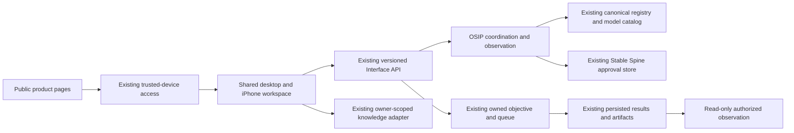

# ORQEVIA 2.0 modernization candidate

Execution mode: deterministic engineering with separate bounded live inference
qualification. This document is a candidate record, not Owner certification.

The 23 October Owner master directive authorizes implementation against the
existing production architecture. Subsequent instructions authorize the PC,
installed CLIs, existing inference fabrics, registered agents and bounded
Hugging Face live qualification. Authentication, product sovereignty, existing
execution controls and read-only GOD'S EYE remain required.

## Observed baseline

- Canonical GitHub main: `77cd1adda077ee537941523e804a3e721650c37f`.
- Preserved release candidate: `f9fa0598a647ec5b3a6cd70df03568758e051dbc`.
- Observed production application: `98b25373207dd55bd1326260a59ebc917144d770`,
  image `sha256:026ff681d12785aa9afd0b55787103d9b028abffe3e5428a96f57f7f38947481`.
- Eleven persistent services recovered after the 23 October Windows login.
  The stopped prior Intelligence container remains a rollback asset.
- `app.production_entry` / `app.direct_entry` own execution; the shared TLS
  `app.interface_server` serves the real `/pwa/` workspace. The separate
  `app/orqevia/ui.py` read-only surface is not the production entrypoint.
- Both inspected public hostnames resolved but returned 403 to the unauthenticated
  public probe. This establishes denial, not authenticated public MFA success.

Host-only evidence is retained outside Git at
`operations/orqevia2-20261023/`; it contains no exported service credentials.

## Public website evaluation and navigation

The existing interface root redirected directly into the operational PWA;
it did not provide the requested six-page public product journey. The older
standalone UI and disabled dashboard action placeholders were separate sources
of navigation confusion. Existing working workspace pages are preserved.

The candidate introduces Overview, Intelligence, Capabilities, Architecture,
Trust & Governance and Access. Public content contains no runtime topology,
private records, credential material or fabricated performance counters. The
Access page leads into the existing authenticated workspace. Shared design
tokens provide dark and light appearances without external font dependencies.

## Runtime boundaries and contracts

OSIP adds bounded, authenticated status and deterministic plan preparation.
Plans reference canonical capabilities and dependency order; they grant no
execution authority. The existing objective contract remains the sole execution
path. Provider configuration, model installation, recorded agent activity and
live inference qualification are distinct observations.

The adapter checks the current session, OWNER role and exact configured owner
account, preserves same-origin mutation checks, bounds requests and responses,
uses a fixed backend target, propagates traces and correlation IDs, sanitizes
upstream failures and limits requests per actor. Approval decisions reuse the
existing store and its idempotent pending-to-terminal transition. They do not
execute the originating action. Missing stores remain unavailable and are not
created by observation.

The existing knowledge adapter remains responsible for private ingestion and
retrieval. Session and task persistence are not represented as semantic memory
or model-weight learning. Other portfolio products are not runtime dependencies.

## Isolated staging and rollback

`scripts/stage_orqevia2.py` prepares a loopback-only stage with distinct data,
owner identity, credentials and TLS certificate. It mounts existing model
artifacts read-only; cloud providers are disabled in this stage. The existing
knowledge implementation uses its pinned ONNX CPU encoder. Stage services have
restart disabled so they do not duplicate production workloads after reboot.
Private Compose and TLS material stay outside Git under the Windows user profile.

The normal Dockerfile packages the public/shared assets. The modernization
Dockerfile overlays reviewed application files on the immutable preserved
production image without reinstalling production dependencies. The separate
staging knowledge image is a test deployment of the existing service.

Production promotion requires a source-bound acceptance receipt, a private
database backup, preserved image/container identities and the exact existing
Compose overlay order. Rollback selects the preserved image and retained data;
no volume or image pruning is part of this release. A staging pass is never
substituted for post-promotion smoke tests.

## Initial qualification record

Fresh production observations at 03:46–03:54 UTC on 23 October 2026:

| Capability | Classification | Evidence and limit |
|---|---|---|
| TLS and anonymous denial | VERIFIED LIVE | TLS 1.2/1.3, wrong-hostname rejection, anonymous API denial; no TLS bypass |
| Existing objective/evidence journey | VERIFIED LIVE | Real Chromium, 13 acceptance checks, 42 API requests without failures, persisted result and digest-checked download |
| Canonical agent queue liveness | VERIFIED LIVE | 21/21 bounded sequential local queue jobs; not full role competence or independent worker heartbeat certification |
| Configured Hugging Face route | VERIFIED LIVE | One classification, one attempt, USD 0.01 cap, gateway-calculated USD 0.00000155; not invoice reconciliation |
| 12B bounded quality | VERIFIED LIVE | 8/8 synthetic contracts, median 4.297 seconds, minimum available host RAM 12,422 MiB; not general coding certification |
| Public facelift and shared design | IMPLEMENTED BUT UNVERIFIED | Candidate code; production root is still the preserved release |
| OSIP status, planning and approvals | IMPLEMENTED BUT UNVERIFIED | Isolated contract/security fixtures pass; deployed integration pending |
| Responsive PWA shell | PARTIALLY IMPLEMENTED | Existing Chromium browser fixtures pass; combined stage and physical-device acceptance pending |
| Physical iPhone and public MFA | BLOCKED | Physical device and authenticated external session are not available to the automated host process |
| Broad model/provider capabilities | PARTIALLY IMPLEMENTED | Only explicitly observed providers and contracts are qualified |
| Formal L7 certification | NOT IMPLEMENTED | No Owner or independent certification claim is made by this release |

The initial browser harness could not resolve the local CA in Node's default
trust source. Using the installed Windows system CA fixed the harness; browser
TLS verification was preserved. A diagnostic collector consumed excessive RAM
and was stopped. Its affected model attempt is retained as incomplete; the
bounded repeated check passed with the stated memory reserve.

The completion report must append actual stage, security, mobile, performance
and promotion receipts before changing these classifications.
