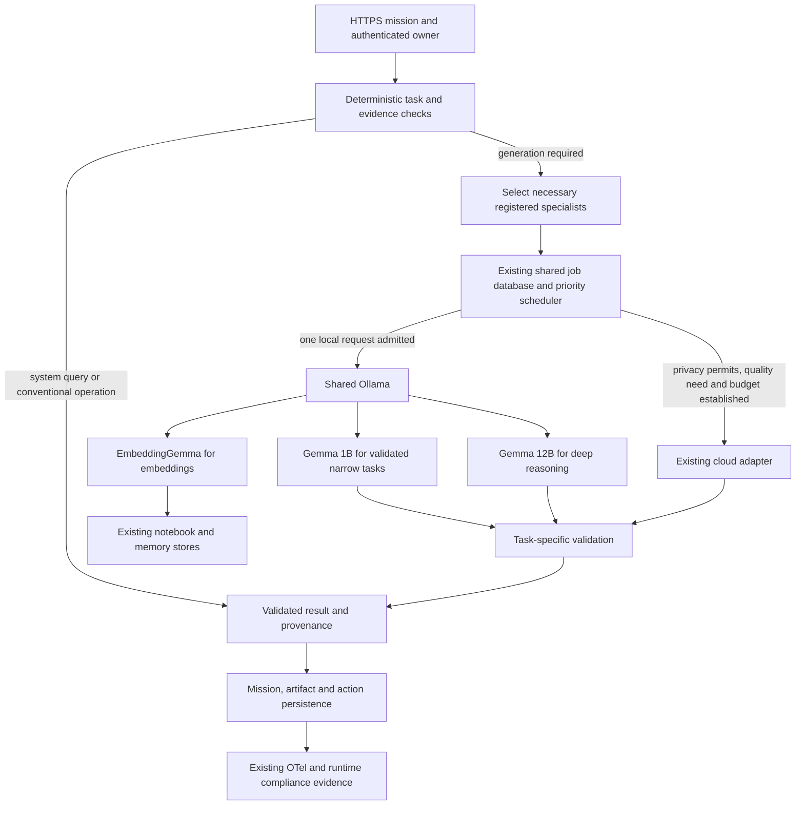

# Proposed architecture and activation rules

Status: under implementation; the diagram includes unimplemented design elements.

1. Preserve every registry ID and allowed delegation edge. Select the smallest
   sufficient specialist set; allow additional independent verification when the
   task requires it. Never collapse independent review into shared generation.
2. Keep deterministic routing first. The existing default-one rule must be
   evaluated on representative labeled missions before a new classifier replaces it.
3. Admit one physical local inference request across logical roles initially.
   Submission concurrency does not create additional hardware capacity.
4. Use explicit lifecycle and timing: QUEUED, ADMITTED, awaiting-first-token,
   INFERENCING, POSTPROCESSING, PERSISTING, terminal outcome. Do not label queue
   waiting as model execution. MODEL_LOADING before first token also includes
   prompt evaluation; use server timing fields for the actual load duration.
5. Keep1B classification disabled for tasks without a passing narrow quality test.
   A failed quality contract escalates deliberately; model confidence alone does
   not establish correctness. Deep tasks never silently downgrade.
6. Cloud escalation is optional. Require an eligible data classification, usable
   provider, actual model suitability, known pricing and task spending authority.
   Local saturation alone is insufficient under patient home operation.
7. Reuse only within verified ownership/freshness/configuration boundaries.
   Existing idempotency returns the same owned job. Cross-mission single-flight
   and completed-result caching remain separate implementation work.
8. Store request fingerprints, source IDs, original dates, result-validation
   outcomes and usage. Do not promote model text to authoritative system facts.
9. Agent roles sleep logically between missions; no21 model replicas or new
   containers are required. Preserve Windows Ollama and its independent clients.
10. Keep1 resident model and2m retention until actual switching and idle tests
    support a change. Add no GPU, model or runtime dependency based on assumptions.

New external acceptance uses verified HTTPS. Existing private transports remain
unchanged until coordinated TLS migration. No Kubernetes, Redis, paid vector DB,
dedicated GPU instance or additional always-on service is required by this design.
