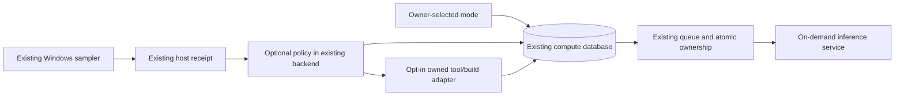

# ABEX Resource Guardian implementation and validation

29 October 2026. **Candidate implemented and tested; production enforcement and
default HOME_ECO qualification remain pending.** The production background pause
has not been resumed. Parent source is the unmerged PR 467 candidate, not main.

## Hardware report and bottlenecks

The read-only audit observed a Ryzen 7 PRO 8840HS, 8 cores / 16 logical CPUs,
32 GiB installed DDR5-5600 (31.33 GiB usable), Radeon 780M, and a healthy 1 TB
Lexar NM610 PRO NVMe with approximately 653 GiB free at audit time. Docker has
15.29 GiB memory and 16 CPUs. GPU counters expose current dedicated/shared use;
512 MiB reported adapter allocation is not the total shared GPU budget. There
is no inference-container GPU mapping, qualified thermal sensor, or detailed
SSD reliability reading available to this ordinary session.

Sixteen half-second baseline samples observed mean CPU 23.03%, peak 45.7%,
at least 16.63 GiB available RAM and about 21 MiB pagefile use. These short
measurements do not establish sustained temperature, saturation, or all-application
responsiveness. Windows servicing reported no pending restart. The active
Ultimate Performance power scheme was inspected and preserved.

The immediate constraints are the VM's finite memory envelope and unqualified
model/render/build combinations. Historical 12B execution at 8192 context used
nearly the VM's memory capacity and FAILED its separate scheduling-answer oracle.
Keep that failure, model assets, and independent numerical validation intact.
No hardware purchase is justified by the bounded development tests here.
Qualify context/thread/residency settings and workload budgets before considering
more memory or additional compute. GPU and thermal assumptions require actual
support/measurement; they are not upgrade recommendations.

## Architecture and implementation

See [the architecture](ARCHITECTURE.md) and [21-agent capacity matrix](CAPACITY.md).
The candidate adds deterministic resource decisions to the existing coordinator
and uses additive tables in its existing SQLite database. It does not install a
new scheduler, resident observer or service container.

Changes:

- `app/resource_guardian.py`: measured capacity/profile validation; freshness,
  memory/commit/CPU/disk/GPU/available-thermal decisions; recovery hysteresis;
  persistent Eco, Balanced, Performance, Mission, Recovery, HOME_ECO and ULTRA_ECO;
  change-only admission records; aggregate execution estimates with sample counts.
- `app/job_queue.py`: optional decisions on both worker and named/direct claims,
  outcome accounting and observable mode/status. Provider selection, locality,
  permissions, costs, token accounting and independent role identities retain
  their existing authority. No profile means the existing policy continues.
- `app/resource_process.py`: owned tool/build processes, atomic capacity permits,
  explicit logical-work identity, duplicate prevention, finite timeout, memory
  budget, sampled RSS/CPU, optional cancellation and eligible-CPU affinity.
  Only owned descendants can be cancelled. A failed cancellation retains capacity;
  a missing PID after an ambiguous spawn is not freed by a clock alone.
- `scripts/Get-ResourceSensors.ps1` and the existing sampler: optional native
  GPU usage, commit, disk activity and explicitly qualified thermal enrichment.
  Unsupported thermal queries remain available on demand. Missing sensors stay
  unavailable, and GPU usage does not become invented capacity.
- `scripts/resource_guardian.py`: observation, persistent mode/status and owned
  process CLI. `config/resource-guardian.abex.example.json` is a clearly marked
  candidate profile; per-model memory qualification is deliberately absent.

The tool adapter must run with the owning service's actual database and process
namespace. ABEX Windows must not open Linux SQLite through UNC/WSL paths or
create a competing production database. The current tests use disposable state;
an HTTPS permit adapter for cross-host Windows builds is not deployed.

## Validation and performance comparison

The earlier focused queue/admission/host/profile suite passed 120 tests.
The final resource-specific suite passed 26 cases, including new cancellation,
uncertain ownership and outcome-accounting cases. These runs overlap; do not sum
them as unique coverage. Cached Ruff 0.17.1 E9/F checks and PowerShell syntax
checks pass. No model call, background resume, driver change or production
component restart was used to obtain those results.

The finite workload partitioned 252 unique application Python files across 21
logical task identities and compiled their syntax without executing/importing
the target code. All 21 partitions completed in each test. One trial was run per
configuration; these figures are not a general speedup or heavy-build capacity claim.

| Configuration | Total wall seconds | Median task seconds | p95 task seconds | Host peak CPU |
|---|---:|---:|---:|---:|
| Sequential baseline | 1.292 | 0.0598 | 0.0803 | 22.7% |
| Guarded, one owned process | 2.141 | 0.1008 | 0.1225 | 40.3% |
| Guarded, two owned processes | 1.597 | 0.1477 | 0.1816 | 39.4% |

The wrapper costs more than direct execution for these tiny commands. Two owned
processes recover part of that overhead; they are still slower than this baseline.
Keep inexpensive deterministic work in-process where appropriate. Host headroom
stayed above 15 GiB, all verified HTTPS checks returned READY, and no safety stop
occurred. The sampling windows were brief and include concurrent Windows activity.

Pure policy evaluation (1000 calls) measured median 3.1 microseconds and p95
3.2 microseconds. The first sensor implementation took 8.115 seconds; native
formatted CIM observations measured 1.032 / 0.847 / 0.843 seconds while preserving
usage/commit/disk visibility and explicit unavailable thermal state. Raw evidence
and original local runs remain retained.

A separate connection diagnostic measured verified HTTPS localhost health at
approximately 2.12 seconds and verified 127.0.0.1 at 0.086-0.100 seconds. This
indicates a client/address-path issue requiring further attribution, not a proven
Python CPU bottleneck. The canonical Owner workbench URL remains unchanged.

## Deployment and remaining risks

| State | Evidence |
|---|---|
| IMPLEMENTED | Candidate policy, same-coordinator integration, sensor extension and owned-process adapter |
| TESTED | Isolated ownership/pressure/cancellation/mode cases and finite source-compilation workload |
| DEPLOYED | Resource Guardian and protected sensor extension are not deployed |
| ENFORCED | Demonstrated inside isolated test transactions/processes; no global host enforcement claim |
| RUNTIME VERIFIED | Existing paused production services and HTTPS navigation; not Guardian production acceptance |

The current ordinary background pause remains generation 0. Known retained queued
jobs are preserved. Historical inactivity is not a failed agent and successful
completion alone is not semantic competence. Mode changes cannot clear the pause.

Outstanding: per-model memory/digest/context qualification, sustained real workload
tests, thermal support, cross-host permit integration, protected collector rollout,
and source-bound running-service verification. Full HOME_ECO default activation
and higher heavy-work concurrency remain HOLD. No paid service or new remote
source transmission was initiated for offloading; existing hosted CI remains an option.

See [deployment and rollback](DEPLOYMENT.md), the raw
[bounded validation](evidence/bounded-validation.json),
[sensor comparison](evidence/sensor-comparison.json),
[hardware audit](evidence/audit-summary.json) and
[HTTPS diagnostic](evidence/https-latency-diagnostic.json).
